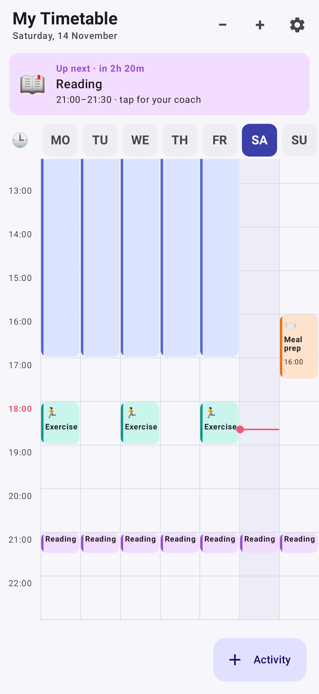
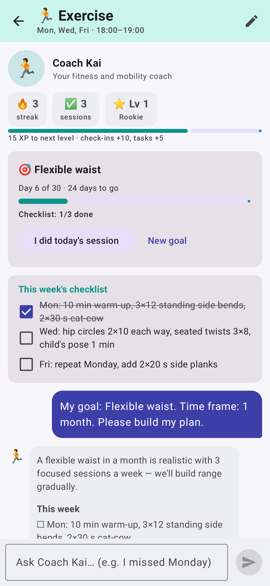
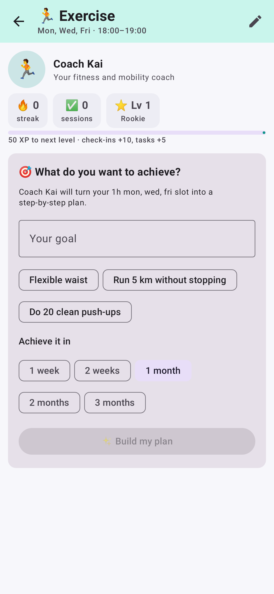

# PA — Timetable, alarms & AI goal coaches (Android)

A weekly timetable that looks like the real thing: **days across the top, hours down the side**.
Every block repeats every week, **rings an alarm when it starts**, and opens its **own AI coach workspace**
that turns a goal ("flexible waist in a month") into a plan that fits that exact time slot.

| Timetable | Coach workspace | Setting a goal |
|---|---|---|
|  |  |  |

## Features

**Timetable**
- Mon–Sun columns, hour rows; today's column highlighted with a live red "now" line.
- Tap any empty slot to add an activity there (snaps to the half hour); tap a block to open its coach; long-press to edit.
- Pick the start and end time (e.g. 05:30–07:30 → shows **2h**), or tap a duration chip.
- Repeat on any days (quick picks: Weekdays / Weekend / Daily). Overlapping blocks are flagged.
- 9 activity types (Studies, Exercise, Work, Reading, Mindfulness, Creative, Meals, Rest, Custom), 10 colours.
- Zoom (− / +) and visible-hour range in Settings. "Now / Up next" card with countdown at the top.
- "Load a sample week" button for first-time users.

**Alarms**
- Rings at the start of each activity, or 5/10/15/30 min early, every week.
- Exact alarms (`setAlarmClock`) that work in Doze; uses your alarm ringtone; can keep ringing until you respond.
- Notification shows today's checklist item, with **Snooze 5 min** and **Open coach** actions.
- Re-booked automatically after reboot, app update, or clock/time-zone change. "Ring a test alarm" in Settings.

**AI coach per activity** (powered by Claude)
- Each type has its own coach (Coach Kai for exercise, Professor Ada for studies, PM Nova for work, …).
- Set a goal and a time frame (1 week to 3 months) → the coach builds a plan sized to your slot
  (e.g. 3 × 1h sessions/week): a 7-day checklist plus week-by-week phases.
- Chat for changes ("I missed Monday", "too easy") — updated checklists replace the old one automatically.
- Coach personality: Calm Mentor 🦉, Drill Sergeant 🪖 or Hype Friend 🎉.

**Motivation**
- "I did today's session" check-ins, 🔥 streaks (counted on scheduled days only), XP and levels
  (Rookie → Legend), goal progress bar (day X of N).

## Setup

1. Install the APK (from the **Actions → Android build → PA-debug-apk** artifact) or build it yourself:
   ```bash
   ./gradlew :app:assembleDebug
   ```
   Output: `app/build/outputs/apk/debug/app-debug.apk`
2. Open **Settings → AI coaches** and paste a Claude API key from https://console.anthropic.com.
   The key is stored only on the phone and sent only to Anthropic. Without a key, the timetable and alarms work and the coaches stay switched off.
3. Allow notifications when asked (needed for alarms).

## Tech

Kotlin + Jetpack Compose (Material 3), min Android 8.0 (API 26), target API 35.
Data is a single JSON file in app storage. AI calls use the official Anthropic Java SDK
(`claude-opus-5-5`, with server-side refusal fallback enabled).

```bash
./gradlew :app:testDebugUnitTest   # scheduling unit tests + renders docs/screenshots/*.png
```
